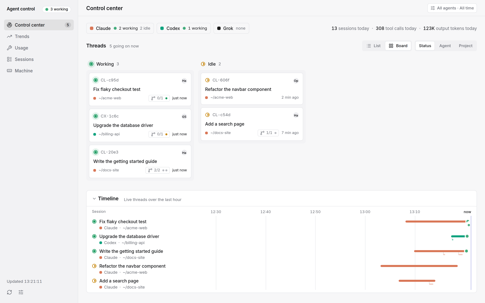
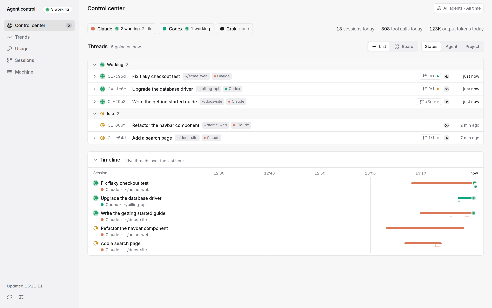
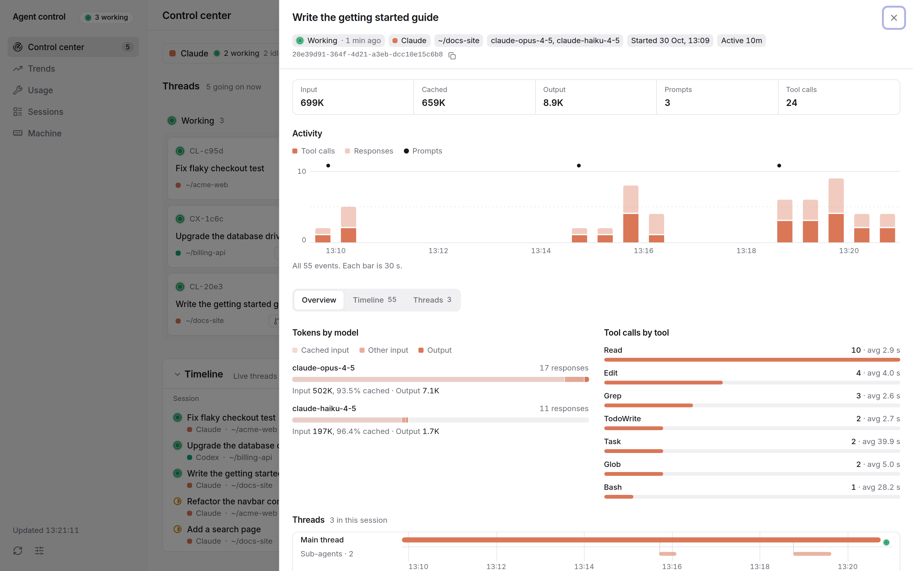
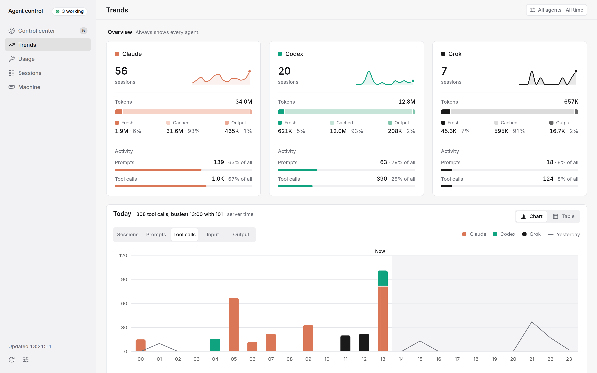
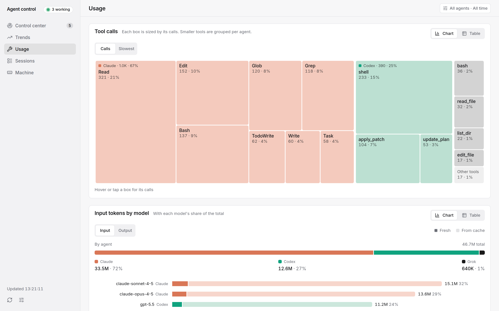
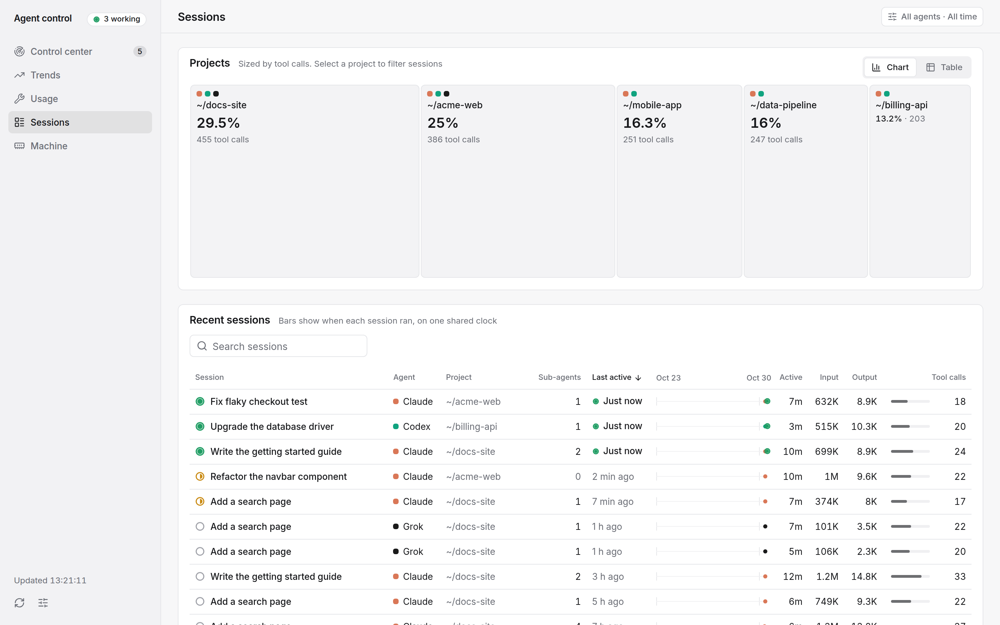

# agent-track

One local dashboard for everything your AI coding agents are doing. See which sessions are working right now, what they cost in tokens, and which tools fail.



## Why

- **One view across agents.** Claude Code, Codex and Grok sessions land in one SQLite store, so you compare them instead of juggling three tools.
- **Live, not just history.** It shows which sessions are working, idle or ended right now, with sub-agents, and how long they have been in that state.
- **Local and read-only.** It reads your agents' session files and never writes to them. Nothing leaves your machine. Python 3.11+ and the standard library only.

## Quickstart

```sh
uvx --from agent-track-cli agent-track serve
```

Then open http://127.0.0.1:3874. Run `agent-track doctor` first to see which agents were found.

To keep it installed instead, use `pipx install agent-track-cli`. Add the `full` extra (`pipx install "agent-track-cli[full]"`) for process and machine data on macOS and Windows.

The PyPI project is `agent-track-cli`. The commands are `agent-track` and `agenttrack`. Do not run bare `pipx install agent-track` or `uvx agent-track`. That name belongs to a different project.

Let your own agent do it. Tell it "install agent-track from https://github.com/quanvu309/agent-track and follow SETUP.md". [SETUP.md](SETUP.md) and [llms.txt](llms.txt) hold the steps.

## Screenshots

All screenshots use synthetic data from `dev/demo_data.py`. No real prompts or projects appear.


*Control center, list view. Threads grouped by status, with sub-agent counts and a live timeline of the last hour.*


*Session detail. Activity over time, tokens by model with cache share, tool calls with average duration, and the sub-agent timeline.*


*Trends. Per-agent sessions, fresh versus cached tokens, and hourly activity for today against yesterday.*


*Usage. A treemap of tool calls per agent and input tokens by model.*


*Sessions. Projects sized by tool calls and a searchable table of recent sessions on one shared clock.*

## Supported agents

| Agent | Sessions and tokens | Titles | Sub-agents | Live state |
|---|---|---|---|---|
| Claude Code | yes | yes | yes | yes (Linux, or with `full`) |
| Codex | yes | yes | yes | yes (Linux, or with `full`) |
| Grok | yes | no | yes | no (no evidence source) |
| T3 Code | no | yes (title overlay only) | no | no |

Fields an agent does not record are shown as empty, never guessed.

## Platform support

| OS | Sessions, tokens, titles | Live state, Machine view |
|---|---|---|
| Linux | full | full, from stdlib `/proc` |
| macOS | full | needs `agent-track-cli[full]` (psutil), otherwise approximate |
| Windows | full | needs `agent-track-cli[full]` (psutil), otherwise approximate, and no service installer |

macOS and Windows have no `/proc`, and the standard library cannot list processes or read memory and CPU. Without a probe, status falls back to file timestamps and is labelled approximate. The Machine view is hidden. Data paths follow the OS. That means XDG on Linux, `~/Library/Application Support` on macOS and `%APPDATA%` on Windows. The default database lives in the OS data directory, never in a repository.

## CLI

```
agent-track doctor [--json]     report which agents, paths and OS probes were found
agent-track serve               ingest at startup and every 60 s, serve the page and API
agent-track ingest              one incremental ingest, print totals
agent-track install-service     systemd user unit (Linux) or launchd plist (macOS); Windows prints manual steps
                                [--port N] [--dry-run] [--enable] [--uninstall]
agent-track skill install       copy the bundled skills into ~/.claude/skills, ~/.codex/skills, ~/.agents/skills
                                (those that exist) [--dest DIR ...] [--dry-run] [--force]
agent-track query totals        JSON on stdout, per-agent totals and last ingest time
agent-track query recent        JSON on stdout, latest sessions [--limit N]
agent-track adapter check PATH  validate an adapter (.py file or module:Class) [--home FIXTURE_DIR] [--limit N] [--json]
```

`serve` options are `--host` (default `127.0.0.1`), `--port` (default `3874`) and `--allow-remote`. `--db PATH` is a top-level flag, so write `agent-track --db PATH serve`. Config is `config.toml` in the OS config directory, and `AGENT_TRACK_*` environment variables override it. Only files whose size or mtime changed are reparsed, so a no-change pass takes well under a second. `POST /api/ingest` (or the Ingest now button) runs a pass on demand. There is no MCP server. The CLI is the tool.

## Privacy and security

The store holds prompt text, tool names and token counts taken from your agents' session files. Treat the database as sensitive.

- `serve` binds `127.0.0.1` by default and only answers requests whose `Host` header is a loopback name on the served port. This blocks DNS rebinding.
- `POST` requests with a cross-origin `Origin` header are refused.
- A non-loopback `--host` requires `--allow-remote` and prints a warning that the data includes prompt text. Never expose the server to a network you do not trust.
- The Machine sampler never reads command lines or environments, and never opens other users' processes.

## Adding an agent

OpenCode, Pi, Gemini and other tools are not built yet. An adapter is one file under `src/agenttrack/adapters/` that implements the `Adapter` contract in [docs/design.md](docs/design.md). Your agent can write it. `agent-track skill install` installs the bundled `agent-track-adapter-author` skill, which walks through it. Third parties can ship an adapter as a package that registers an entry point in the group `agent_track.adapters`. Validate any adapter with `agent-track adapter check <path>`.

## API

All endpoints are `GET` unless noted. Timestamps are UTC ISO with milliseconds (`2026-10-12T09:31:45.000Z`).

| Endpoint | Returns |
|---|---|
| `/api/summary`, `/api/daily`, `/api/today`, `/api/models` | totals and breakdowns |
| `/api/tools`, `/api/reliability`, `/api/heatmap`, `/api/projects` | tool use, failures, activity, per-project |
| `/api/sessions`, `/api/session/<id>` | session list and detail |
| `/api/live?minutes=N` | recently active sessions with state |
| `/api/burn`, `/api/machine` | token burn and machine view, below |
| `POST /api/ingest` | run an ingest pass now |

### `GET /api/burn`

Token use summed per UTC time bucket and harness. Only buckets with events are returned. Fresh input is `input_tokens - cached_tokens`.

| Param | Values | Default |
|---|---|---|
| `minutes` | 1 to 2880, clamped | 120 |
| `bucket` | bucket width in minutes: 1, 5, 15 or 60 | 5 |
| `harness` | an agent id such as `claude`, `codex`, `grok` | all |

A non-integer `minutes`, another `bucket` or an unknown `harness` is a 400. Buckets align to UTC epoch multiples.

```json
{"bucket_minutes": 5, "since": "2026-10-12T07:30:00.000Z", "until": "2026-10-12T09:34:12.345Z",
 "rows": [{"ts": "2026-10-12T09:30:00.000Z", "harness": "claude", "input_tokens": 1513, "cached_tokens": 509,
           "output_tokens": 72, "prompts": 1, "tool_calls": 2, "responses": 4}]}
```

### `GET /api/machine?minutes=60`

`minutes` is 1 to 10080 (7 days), clamped, default 60. `now` is the sampler's latest snapshot, or `null` before the first sample. `series` averages stored samples into equal UTC buckets of `bucket_seconds` (15 s minimum, at most about 300 points). Memory and disk values are bytes.

```json
{"now": {"ts": "2026-10-12T10:24:18.265Z", "mem_total": 16324280320, "mem_used": 14938083328, "mem_available": 1386196992,
         "swap_total": 8589930496, "swap_used": 8589725696, "cpu_pct": 99.7, "load": [74.67, 83.51, 77.1], "cpus": 8,
         "uptime_s": 347369, "disk_used": 139842347008, "disk_total": 160921083904, "procs": 747,
         "agents": [{"harness": "claude", "mem": 1343008768, "procs": 4}, {"harness": "other", "mem": 12950040576, "procs": 551}],
         "top": [{"pid": 3519080, "comm": "claude", "harness": "claude", "project": "projects/acme", "mem": 431648768}]},
 "bucket_seconds": 15,
 "series": [{"ts": "2026-10-12T10:24:15.000Z", "mem_used": 14938083328, "swap_used": 8589725696, "cpu_pct": 99.7, "load1": 74.67,
             "agents": {"claude": 1343008768, "other": 12950040576}}]}
```

- On Linux, `mem_used` is `MemTotal - MemAvailable`, so reclaimable page cache is not counted. `swap_used` is `SwapTotal - SwapFree`.
- `cpu_pct` is busy time across all CPUs between two consecutive samples. It is `null` on the first sample after start.
- `disk_*` is the filesystem holding the database.
- `procs` counts every process on the machine. `agents` and `top` cover only processes owned by the user running the server.
- `agents` has one entry per agent plus `other`, always in that order. `mem` is private resident memory where the OS reports it (Linux RssAnon), so per-agent numbers do not add up to more than RAM.
- `top` is the 12 largest of those processes by `mem`.
- Any field the machine does not expose is `null`. The server keeps running.

The sampler takes one sample at startup, then one every 15 s on its own thread. A process belongs to an agent when its name equals one of the adapter's `process_names` or starts with that name plus `-`. Child processes such as shells, MCP servers and dev servers count as `other`. Samples older than 7 days are deleted in the same transaction as each insert. The database holds only per-agent totals; the process list is kept in memory. History grows about 1.8 MiB a day.

### `GET /api/live?minutes=N`

Root sessions with at least one event in the last `minutes`, most recent first. Each row has the fields of `/api/sessions` plus `recent_events`, `recent_input`, `recent_output`, `recent_failed`, `recent_tool_calls`, and:

- `state`: `"working"`, `"idle"`, `"ended"` or `null`. Read from the machine, never from the database. `null` means no evidence for that agent, so a client falls back to the age of `last`.
- `state_since`: timestamp of the record that decided `state`, or `null`.
- `pid`: the live process behind the session, or `null`.
- `thread_rows`: every thread of the session ordered by `started_at`, each with its own `state`, token and tool counts.

`/api/sessions` rows and the `session` object of `/api/session/<id>` carry the same `state`, `state_since` and `pid`.

### Counting rules

- **Claude.** One session per top-level transcript `sessionId`. Sub-agent files roll up into it. Tokens come from one line per `message.id`, the one with max `output_tokens`, because streaming repeats usage across lines.
- **Codex.** One session per root `session_id` in the rollout `session_meta`. Tokens are `token_usage_record` lines, unique per `response_id`.
- **Grok.** One session per `summary.json` whose `session_kind` is not `subagent`. Tokens are `usage.json` turns plus later `turn_completed` usage. Root only, because a parent turn already includes its sub-agents.
- **Titles.** The agent's generated title, else for a Claude sub-agent its meta description, else the first prompt, cleaned of command and system markup. When a session was launched from T3 Code, T3's thread title wins for the root thread.
- Input tokens include cache reads and writes. "Cached" is the cache-read subset.

## Development

```sh
git clone https://github.com/quanvu309/agent-track && cd agent-track
PYTHONPATH=src python -m unittest discover -s tests
cd web
pnpm install
pnpm build     # type-checks, then writes ../src/agenttrack/static (gitignored)
pnpm lint
pnpm dev       # hot reload, proxies /api to 127.0.0.1:3874; run `agent-track serve` alongside
```

The frontend is Vite, React, TypeScript, Tailwind and shadcn/ui. The Inter font is bundled, so the page loads nothing from the network. Releases are built by tagging `v*`. The workflow builds the web UI into the wheel and publishes to PyPI.

### Demo data

`dev/demo_data.py OUT_DIR` writes about two weeks of invented Claude Code, Codex and Grok sessions into a scratch home, using the same on-disk formats the adapters parse. It is deterministic for a seed, uses stdlib only and never reads your real home. On Linux it also starts a few short-lived placeholder processes so live status is real. Use it for screenshots and demos.

```sh
python3 dev/demo_data.py ~/tmp/demo-home
HOME=~/tmp/demo-home PYTHONPATH=src python3 -m agenttrack --db ~/tmp/demo-home/db.sqlite serve --port 3999
```

The Machine view reads the real host, so it is left out of the screenshots.

## License

MIT, see [LICENSE](LICENSE).
